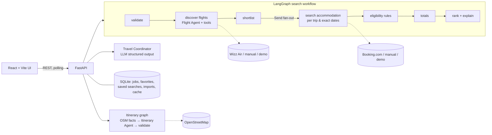

# TravelScout

A multi-agent travel discovery app that finds the **cheapest realistic trip**, not just the cheapest advertised flight. It combines:

- **Wizz Air** round-trip fares,
- **Booking.com** stays rated **≥ 7.5** with a **confirmed private bathroom** for the selected room,
- a **day-by-day sightseeing plan** built on OpenStreetMap data,

and ranks packages by the total cost of a usable trip. Known costs, requested extras, labelled estimates and unknown costs are kept separate.

TravelScout recommends and links out to providers. It never books, purchases or asks for payment details.

The UI is in Serbian (Latin script) and shows prices in EUR by default (RSD optional).

---

## Features

- Search form plus optional natural-language request ("Vikend u Rimu za dvoje u novembru…"), interpreted by the **Travel Coordinator** agent. The interpreted constraints are shown so you can correct them.
- Flexible date windows, *Anywhere* discovery, several departure airports (BEG default; INI, TZL, SKP, TSR, BUD, SOF, TGD).
- Strict accommodation rules. Anything that cannot be proven goes to a separate **Needs verification** list.
- Transparent cost breakdown, Decimal money, timestamped FX rates (ECB + NBS).
- Live agent progress (stages and tool calls, no private reasoning), cancellation, partial results.
- Filters, side-by-side comparison of up to 3 trips, favorites, saved searches.
- On-demand itineraries with map links, OSM opening-hours tags and transfer route links.
- Export of a trip and its itinerary as Markdown or JSON.
- Integration-status panel and a **live / cached / manual / demo / unverified** badge with timestamp on every result.

## Data access: read this first

| Source | Status | Notes |
|---|---|---|
| OpenAI | **Required for agents** | Default model `gpt-5.4-mini` (override with `OPENAI_MODEL`). |
| DEMO dataset | Always available | Fictional data (every property name starts with "DEMO") that exercises every rule. Never mixed with live data. |
| Wizz Air (public site endpoints) | Opt-in `WIZZ_LIVE_ENABLED=true` | No official API exists. Reads the public route map and lowest-fare calendar. Flight numbers, arrival times and bag prices are bot-protected and **not** bypassed, so arrivals are estimates and bag prices are "unknown". |
| Booking.com (visible browser) | Opt-in `BOOKING_SCRAPER_ENABLED=true` | The Demand API needs an affiliate contract. A visible Playwright Chromium window reads the exact-date property pages. No CAPTCHA solving, stealth or proxies. |
| OpenStreetMap (Nominatim + Overpass) | On by default | Attractions, coordinates, `opening_hours`/`fee` tags. Community data: verify before you go. |
| ECB (Frankfurter) + NBS (kurs.resenje.org) | On by default | FX rates. Fallback rates are clearly flagged. |
| Manual import | Always available | Paste or type offers you found yourself; labelled "Ručni unos". |

**Only an OpenAI key:** all agents, the full demo flow, manual import, OSM itineraries and provider links.<br>
**Additional opt-in:** live Wizz Air fares and live Booking.com rooms (no extra credentials; Chromium for Booking).<br>
**Unavailable:** official Wizz/Booking APIs, Wizz flight numbers/bag prices, and any booking or payment.

The Wizz Air and Booking.com readers use undocumented website behaviour. They can break at any time and may conflict with those sites' terms. They are meant for personal, low-volume use. Details: [docs/PROVIDERS.md](docs/PROVIDERS.md).

## Architecture



**Agents**

| Agent | LLM role | Deterministic code |
|---|---|---|
| Travel Coordinator | Turns text into a typed `CoordinatorDraft` (structured output). | Merges it into the form values, validates with Pydantic, reports every change. The 7.5 floor cannot be lowered. |
| Flight Agent | `create_agent` with two tools: `list_wizz_destinations` and `search_round_trips`. | Tools store `FlightOption`s in a registry; the LLM only sees summaries and can't touch prices. A coverage check searches anything it skipped. |
| Accommodation Agent | Writes short explanations from typed, validated facts (never raw page text). | Provider calls for exact stay dates; eligibility rules; cheapest eligible offer per trip. |
| Itinerary Agent | `create_agent` with a `find_attractions` tool (OSM); plans days with `ItineraryDraft` structured output. | Rejects days outside the trip; links items to real POIs; anything unverifiable is labelled; budgets come from tables. A rule-based planner is the fallback. |

Arithmetic, dates, time zones, FX, filtering and ranking are plain Python (`backend/app/services`). The LLM is used for interpretation, tool selection and explanations.

**Ranking.** The primary key is the comparable total (known costs + labelled estimates). Quality, location and usable time can each move a package by at most about 6 % of its cost (weights are configurable), so a much cheaper trip is never outranked by a slightly nicer one. Unknown costs add a small penalty and are always shown.

**Reliability.** Each agent has a bounded number of model and tool calls. Searches have provider timeouts and limited retries, use bounded concurrency, and run under a hard per-search time budget (`MAX_JOB_SECONDS`). Expensive accommodation searches only run for a configurable shortlist. Responses are cached in SQLite, searches can be cancelled, and if a provider fails the other results are kept.

**Security.** Server-side fetches go through an allowlist that blocks localhost, private and link-local ranges, metadata IPs, IP literals and non-https URLs (redirects are checked at every hop). External pages and imported text are treated as data, never as instructions. Secrets are redacted from logs and error messages. The frontend never receives keys.

### Repository layout

```
backend/
  app/
    agents/      coordinator, flight_agent, accommodation_agent, itinerary_agent, llm, context
    graph/       workflow.py (LangGraph search graph)
    providers/   wizz, booking (+ booking_parse), osm, fx, manual, demo, http
    services/    eligibility, costing, ranking, timeplan, flights, money, export
    domain/      models.py (Pydantic), airports.py
    main.py      FastAPI app (also serves frontend/dist when built)
  tests/         pytest suite with fixtures (no network)
frontend/        React + TypeScript + Vite
docs/PROVIDERS.md
```

## Setup (Windows PowerShell)

Prerequisites: Python 3.12+ (developed on 3.14), Node.js 20+ (developed on 24), Git.

```powershell
# 1. Configuration: put .env in the repository root (next to README.md)
if (-not (Test-Path .env)) { Copy-Item .env.example .env }
notepad .env          # set OPENAI_API_KEY; optionally WIZZ_LIVE_ENABLED / BOOKING_SCRAPER_ENABLED

# 2. Backend
cd backend
python -m venv .venv
.\.venv\Scripts\python -m pip install -r requirements.lock
.\.venv\Scripts\python -m playwright install chromium    # only needed for live Booking.com
.\.venv\Scripts\python -m uvicorn app.main:app --reload --port 8000

# 3. Frontend (second terminal)
cd frontend
npm ci
npm run dev           # http://localhost:5173  (proxies /api to :8000)
```

Single-process alternative: run `npm run build` in `frontend`, then start only the backend and open http://127.0.0.1:8000.

macOS/Linux: same steps with `.venv/bin/python`.

### Try it

1. Leave **Demo podaci** selected and click **Pronađi putovanja**. The full workflow runs on fictional data.
2. Type a request such as *"Rim ili Barselona za dvoje u novembru, 3–4 noći, do 450 € po osobi"* and click **Protumači**.
3. Open **Plan putovanja** on a card, tick **Uporedi** on two or three cards, or export Markdown/JSON.
4. For real data, set `WIZZ_LIVE_ENABLED=true` and `BOOKING_SCRAPER_ENABLED=true`, restart the backend, and choose **Stvarni podaci**. A Chromium window opens for each Booking.com search; don't close it. A 2-destination search took about 1 minute in testing.

## Tests and checks

```powershell
cd backend
.\.venv\Scripts\python -m pytest -q            # 114 tests, fixtures only, no network
.\.venv\Scripts\ruff check app tests
.\.venv\Scripts\mypy app
.\.venv\Scripts\python -m pytest -m live -q    # optional: real OpenAI call (uses your key, costs a little)

cd ..\frontend
npm run typecheck
npm run build
```

The tests cover:
- review-score threshold and missing scores;
- hostels, dorms and shared or unconfirmed bathrooms;
- room occupancy and exact stay dates;
- costs with baggage, mandatory fees and multiple currencies;
- DST and time-zone edge cases, including overnight arrivals;
- provider failures and keeping demo, live and manual data separate;
- ranking;
- the URL guard and secret redaction;
- the Booking.com and Wizz Air parsers (against synthetic fixtures);
- the API end to end.

CI (`.github/workflows/ci.yml`) runs lint, type checks and tests on Python 3.12 and 3.14, the frontend type check and build, and a simple secret scan.

## Privacy and tracing

LangSmith tracing is **off** by default and only activates when both `LANGSMITH_TRACING=true` and `LANGSMITH_API_KEY` are set. When enabled, it sends prompts, tool calls and results (search constraints, flight/hotel summaries, OSM attraction lists) and model outputs to LangSmith. API keys are never part of those payloads.

## Roadmap ideas

- Authentication and per-user data: tables are plain JSON documents, ready for a `user_id` column.
- Price alerts: cached searches plus a scheduler.
- Support more providers through the `FlightProvider` / `AccommodationProvider` protocols.
